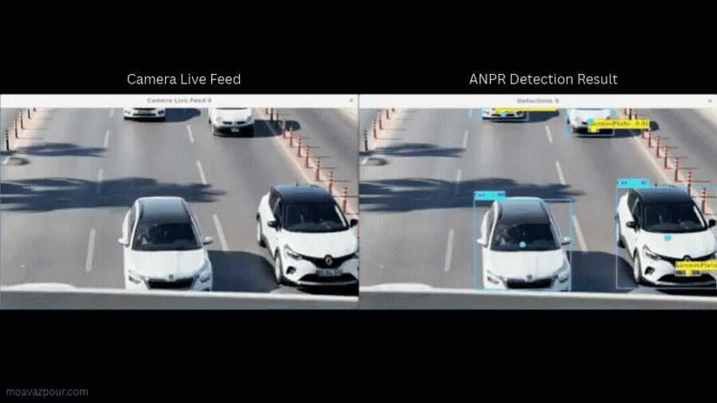

# Automatic Number Plate Recognition at the Edge



A real-time ANPR engine running on the edge computer beside each camera — plate detection, OCR, multi-object tracking and best-frame capture — built for customers' parking gates and industrial-site access control.

**[Live case study →](https://moavazpour.com/projects/automatic-number-plate-recognition)**

## Overview

The engine runs on the edge computer next to each camera: frames arrive over RTSP or straight from a Basler industrial camera, get run through YOLOv4-family plate detection and OCR, and are tracked across frames so that each vehicle's clearest frame is the one that gets stored. Finished records are written to a local MySQL database and pushed to a central server over an encrypted REST API.

The deployment grew from an 8-camera pilot to 74 cameras at customer parking gates and industrial sites.

- **Company:** Anamis Electronic Vira (GambroTech), Bandar Abbas — ITS startup, ~15 technical staff
- **Role:** Computer Vision Engineer (Junior → Mid-level), full-time
- **Timeframe:** 10/2022 — 02/2025

## Problem & context

The engine had to read plates reliably for customers' parking gates and industrial-site access control — in Bandar Abbas's strong sun, glare, dust and full darkness — from an edge computer already mounted in the roadside cabinet next to each camera. That computer ranged from a Jetson Nano down to a low-power Intel Atom industrial PC, so the pipeline had to make every one of those budgets work rather than assuming capable hardware. Every finished record then had to reach a central server over a secure link the rest of the company's software could also consume.

## My role

I was a core developer of the company's edge ANPR engine, with growing ownership of its perception pipeline and edge deployment: I developed the detection and OCR pipeline, trained and evaluated the detection models, migrated the performance-critical parts to multithreaded C++, integrated the Basler cameras, and implemented the REST APIs plus the C++ DLL that the UI team's C# application calls into via P/Invoke.

## Architecture

```
Basler camera            Edge computer                MySQL          REST API           Central
+ LED flash    ───────►  YOLOv4 detection    ───────►  (local)  ───► HTTPS / TLS ─────►  server
                          OCR + tracking                record
                          (Jetson / industrial PC)      storage
```

## Key technical decisions

### Data and model
- The training data was a 7,000+ image field dataset of cars, motorcycles and plates — different weather, light and viewing angles. I had selected and curated these images and defined the dataset structure toward the end of my working-student role at the company; annotation was done by a fellow trainee.
- Trained and evaluated YOLOv4-family detection models (YOLOv4-tiny for edge deployment) on this dataset, balancing accuracy and speed for low-power hardware.

### Real-time C++ pipeline
- Migrated the performance-critical parts from Python to multithreaded C++: RTSP frame ingestion, YOLO inference, OCR post-processing, MySQL storage and camera reconnection handling.
- Evaluated OpenCV, GStreamer and libVLC as streaming back ends to cope with unstable camera links.
- Added motion-gated processing (skipping static frames), direction-of-travel detection, multi-object tracking and best-frame selection per vehicle to improve OCR reliability.

### Running on weak edge hardware
- Up to ~12 FPS end to end — frame ingestion to database — on the standard company edge PCs (CPU-only processing).
- On NVIDIA Jetson Nano, optimised YOLOv4-tiny with TensorRT (FP16) to ~25 FPS inference, serving up to 4 gate cameras per device with motion gating.
- Added a CUDA-accelerated OpenCV DNN mode for multi-camera sites; hands-on testing of ONNX Runtime.
- Reduced RAM and CPU usage to run on Jetson Nano and other low-power industrial edge PCs.
- On the weakest deployed hardware (Intel Atom E3845, CPU only, pipeline capped at ~5 FPS vs. a 15 FPS camera), at an entry/exit-logging gate without a barrier where vehicles passed faster, I redesigned buffering with a motion-gated centre-ROI buffer feeding a dedicated inference thread. This raised vehicle capture from under 30% to ~70% within the same compute budget; peak traffic could still overflow the buffer.

### Cameras and integration
- Integrated Basler industrial cameras through the Pylon SDK in C++: frame acquisition, exposure control and synchronisation with the LED flash.
- Implemented REST APIs over HTTPS/TLS: one for camera-to-server data transfer, and one the web UI used to control the engine and fetch results.
- Wrote a native C++ DLL with the plate-recognition logic, exposed via P/Invoke and used in production by the UI team's C# application.

## Real deployment — from 8 to 74 cameras

The engine was piloted on 8 cameras for customers' parking gates and industrial-site access control, then rolled out to 74 cameras at customer parking gates and industrial sites.

**Field test (09/2024):** 1,200 vehicles at barrier gates on GPU-based hardware, manually verified and spread over all 24 hours of the day (all lighting conditions). No vehicle was missed and 99.4% of plates were read exactly right; each of the 7 errors was a single wrong character on a damaged or dirty plate. A repeat test months apart under similar conditions confirmed the result.

*Published with the permission of Anamis Electronic Vira.*

| Metric | Value | Context |
|---|---|---|
| Missed vehicles | 0 of 1,200 | field test 09/2024, barrier gates, GPU-based hardware, all 24 hours |
| Exact plate reads | 99.4% | same field test; all 7 errors were a single wrong character on a damaged or dirty plate |
| Cameras deployed | 74 | grown from an 8-camera pilot |
| End-to-end throughput | up to ~12 FPS | frame ingestion → database, standard edge PC, CPU only |
| NVIDIA Jetson Nano | ~25 FPS inference | YOLOv4-tiny, TensorRT FP16, up to 4 gate cameras per device |
| Vehicle capture, Intel Atom E3845 | <30% → ~70% | motion-gated centre-ROI buffering, same ~5 FPS budget |

## Tech stack

C++ · Python · OpenCV · YOLOv4 family (YOLOv4-tiny) · CUDA · TensorRT · ONNX Runtime (testing) · NVIDIA Jetson · Embedded Linux · Multithreading · RTSP · GStreamer · libVLC · Basler Pylon SDK · MySQL · REST APIs (HTTPS/TLS) · Multi-object tracking · C++ DLL / P/Invoke

## Source code

This repository documents the project for portfolio purposes. The production source code itself remains proprietary to Anamis Electronic Vira.

## License

[MIT](LICENSE) — applies to the documentation in this repository.
